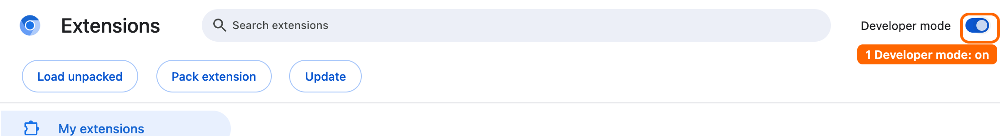
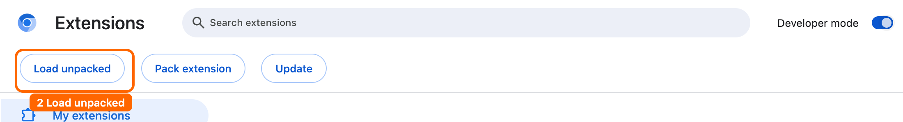
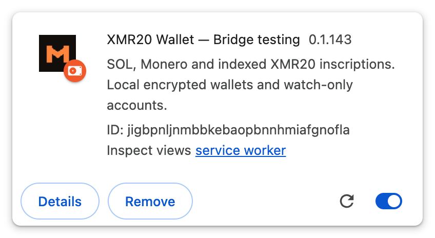
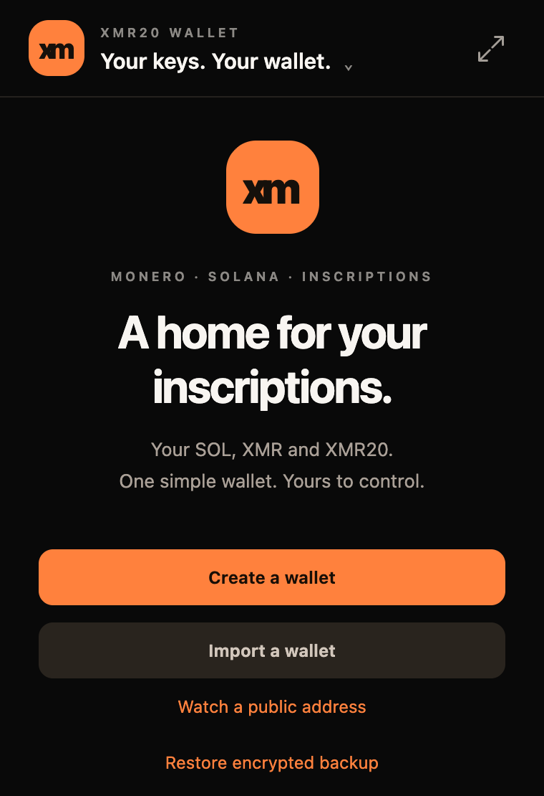

# Install XMR20 Wallet for Chrome

About 5 minutes. It works in **Chrome**, **Brave** and **Edge**, on Windows, Mac and Linux. You don't need to build
anything or open a terminal.

> **Experimental software, real funds.** The wallet works on Monero and Solana **mainnet**. It has **not** had an
> independent security review. Use small amounts you can afford to lose, and write down your recovery phrases.

XMR20 Wallet is not in the Chrome Web Store. You install it from a zip file with Chrome's **Developer mode**, which is
the standard Chrome setting for installing an extension from a folder.

## 1. Download the zip

1. Open the [latest release](https://github.com/xmr20project/xmr20-wallets/releases/latest).
2. Under **Assets**, click **`XMR20-Wallet-0.1.143.zip`** (the version number may be newer).

## 2. Unzip it into a folder you will keep

- **Mac:** double-click the zip. You get a folder named `XMR20-Wallet-0.1.143`.
- **Windows:** right-click the zip, choose **Extract All…**, then **Extract**.
- **Linux:** `unzip XMR20-Wallet-0.1.143.zip`

Move the folder somewhere it can stay, for example your **Documents** folder. Chrome runs the wallet from this folder,
so don't delete or move it afterwards.

## 3. Open the extensions page

Type this in the address bar and press Enter:

| Browser | Address |
|---|---|
| Chrome | `chrome://extensions` |
| Brave | `brave://extensions` |
| Edge | `edge://extensions` |

## 4. Switch on Developer mode

The switch is in the top right corner (in Edge it is in the menu on the left).

## 5. Click "Load unpacked" and choose the folder

Three new buttons appear. Click **Load unpacked**.

Choose the **`XMR20-Wallet-0.1.143`** folder from step 2 and click **Select** (on a Mac, **Select** or **Open**).
Choose the folder itself, not a file inside it.

The wallet's card appears. Its ID is always `jigbpnljnmbbkebaopbnnhmiafgnofla`.

## 6. Pin it to the toolbar

Click the **puzzle-piece** icon to the right of the address bar, then the **pin** next to XMR20 Wallet. The wallet's
icon now stays in the toolbar. Click it to open the wallet.

## 7. Create or import a wallet

- **Create a wallet** makes new keys. Write the recovery phrases on paper and keep them somewhere safe. They are the
  only way to get your funds back if this computer breaks, and nobody else can recover them for you.
- **Import a wallet** if you already have a recovery phrase or key, for example from an earlier install or from the
  terminal wallet.
- **Watch a public address** shows the balances of an address without any keys.
- **Restore encrypted backup** restores a backup file (and its password) saved from XMR20 Wallet.

The password you choose locks the wallet on this computer. It is not a recovery phrase.

The first scan of a new account can take a few minutes. After that, the wallet only scans new blocks.

## Updating to a new version

1. Download and unzip the new version.
2. Copy **everything inside** the new folder into your existing wallet folder, and replace the old files when asked.
3. Open the extensions page again and click the **reload arrow** (↻) on the XMR20 Wallet card. The card shows the new
   version number.

Your wallets stay.

> **Never click "Remove" on the XMR20 Wallet card.** Removing the extension deletes the wallets saved in it. If you
> already have XMR20 Wallet loaded from another folder, update that folder instead of loading a second copy.

## If something goes wrong

- **"Manifest file is missing or unreadable"**: you chose the wrong folder. Choose the folder that has `manifest.json`
  directly inside it. On Windows, **Extract All** sometimes makes a folder inside a folder: go one level deeper.
- **Chrome reminds you that developer mode extensions are on**: that is expected for an extension installed from a
  folder. Close the message; don't choose to disable the extension.
- **The toolbar icon is missing**: pin it again (step 6).

## Check your download (optional)

The release page lists the zip's SHA-256 fingerprint in `SHA256SUMS.txt`. To compare:

- **Mac / Linux** (Terminal, in the folder with the zip): `shasum -a 256 XMR20-Wallet-0.1.143.zip`
- **Windows** (Command Prompt, in that folder): `certutil -hashfile XMR20-Wallet-0.1.143.zip SHA256`

The long code it prints must match the one on the release page exactly.

## Build it yourself instead

If you would rather build the extension from this repository, see [`extension/README.md`](extension/README.md).
